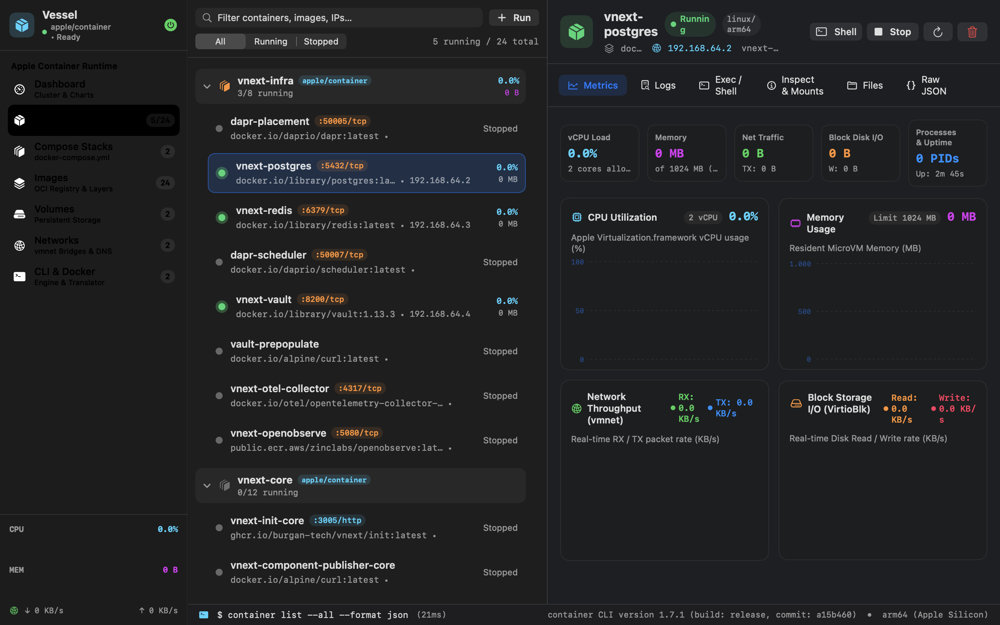

# Vessel — Native macOS Container Studio for `apple/container`

**Vessel** is a fast, lightweight (~2.5 MB), 100% native macOS desktop UI built with **SwiftUI + Swift Charts** for Apple's Linux microVM container runtime ([github.com/apple/container](https://github.com/apple/container)) with built-in, zero-conversion **`docker-compose.yml`** support.



---

## Step-by-Step Getting Started

### Step 1 — Install & Start Apple's `container` Engine
Vessel runs on top of Apple's official `container` runtime (requires an **Apple Silicon Mac** running **macOS 15+**).

1. **Install `apple/container`:**
   ```bash
   brew install --cask container
   ```
2. **Start the background engine:**
   ```bash
   container system start
   ```
3. *(Optional)* **Enable local DNS so containers in a Compose stack can reach each other by service name (`*.test`):**
   ```bash
   sudo container system dns create test
   container system property set dns.domain test
   ```

---

### Step 2 — Install Vessel via Homebrew
Install **Vessel** directly via Homebrew:

```bash
brew tap middt/vessel https://github.com/middt/apple-container-ui
brew install --cask vessel
```

Launch **Vessel** from **Applications** (or via terminal):
```bash
open -a Vessel
```

---

### Step 3 — Run a Single Container in Vessel
1. Open **Vessel** and click **`+ Run Container`** (`Cmd + N`) in the top-right toolbar (or click **Launch** on any 1-click template like **`httpbin`**, **`nginx`**, **`postgres`**, or **`valkey`** on the **Dashboard**).
2. Enter the container settings:
   - **Name:** `httpbin`
   - **Image:** `mccutchen/go-httpbin:v2.15.0`
   - **Resources:** `2 vCPU`, `512 MB RAM`
   - **Port:** `8090` → `8080` (`HTTP`)
3. Click **`Create & Boot MicroVM`**.
4. Once running, click **`:8090`** in the header (or **`Open http://localhost:8090`** under *Inspect & Mounts*) to open it in your browser, or click **`Shell`** to open an interactive terminal inside the microVM.

---

### Step 4 — Run a `docker-compose.yml` Stack in Vessel (Zero Conversion)
You do **not** need to convert your `docker-compose.yml` files. Vessel reads standard Compose files and boots every service directly on `apple/container`.


1. In **Vessel**, click **`Compose Stacks`** (`Cmd + 3`) in the left sidebar.
2. Click **`Import YAML`** in the top-left and select any `docker-compose.yml` file from your Mac.
   *(If you want a quick example to test with, save the file below as `docker-compose.yml` and import it):*
   ```yaml
   version: "3.9"
   services:
     httpbin:
       image: mccutchen/go-httpbin:v2.15.0
       cpus: 2
       mem_limit: 512m
       ports:
         - "8090:8080/http"
     api-gateway:
       image: nginx:1.27-alpine
       cpus: 2
       mem_limit: 512m
       ports:
         - "8080:80/http"
       depends_on:
         - httpbin
     cache:
       image: valkey/valkey:8.0-alpine
       cpus: 1
       mem_limit: 512m
       ports:
         - "6379:6379/tcp"
   ```
3. Make sure the engine dropdown in the top-right is set to **`Apple Container (MicroVM)`** (or switch to **`Docker CLI Engine`** if you prefer to run it on Docker).
4. Click **`Stack Up`**.
   - Vessel automatically creates the network, volumes, and microVM containers in `depends_on` order.
   - Switch to the **`Containers`** tab to see all stack services grouped together with aggregate CPU/Memory charts and 1-click bulk **Start / Stop / Restart / Delete** controls.

---

## Application Screenshots

### 1. Cluster Dashboard & Real-Time Charts
Live cluster CPU, Memory, `vmnet` Network RX/TX, and Disk I/O telemetry alongside per-container resource distribution and 1-click microVM templates.


### 2. Containers Inspector (Metrics, Logs, Exec/Shell, Mounts, Files & Raw JSON)
Grouped by Compose project with protocol-aware port actions (**Open in Browser** & **Test HTTP Output** for HTTP/HTTPS services; **Copy TCP Endpoint** for raw TCP sockets like PostgreSQL and Redis/Valkey).


### 3. Zero-Conversion `docker-compose.yml` Stack Manager
Edit `docker-compose.yml` live in the UI, inspect the generated `apple/container` execution plan, and view combined stack logs.


---

## Documentation

| Document | Description |
| :--- | :--- |
| **[User Guide (`docs/USER_GUIDE.md`)](docs/USER_GUIDE.md)** | Complete walkthrough of all screens, keyboard shortcuts, and features. |
| **[Docker & Compose Guide (`docs/COMPOSE_AND_DOCKER_GUIDE.md`)](docs/COMPOSE_AND_DOCKER_GUIDE.md)** | How zero-conversion `docker-compose.yml` orchestration works on `apple/container`. |
| **[Architecture (`docs/ARCHITECTURE.md`)](docs/ARCHITECTURE.md)** | Internal architecture, CLI parsers, Compose DNS networking, and build pipeline. |
