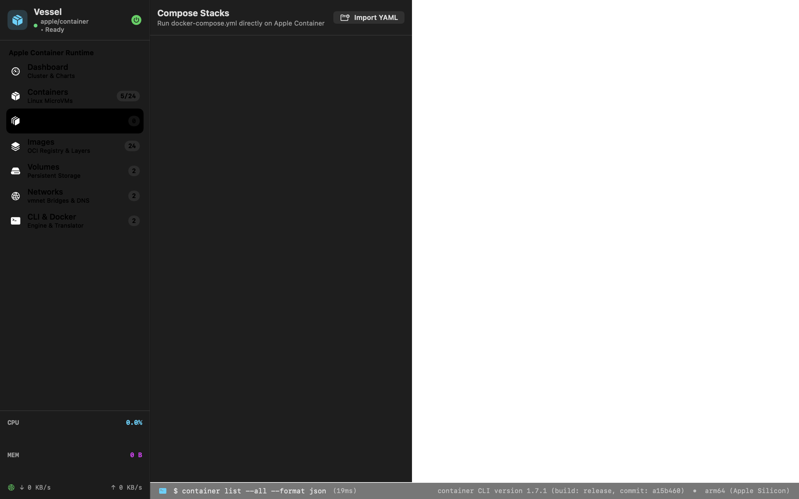
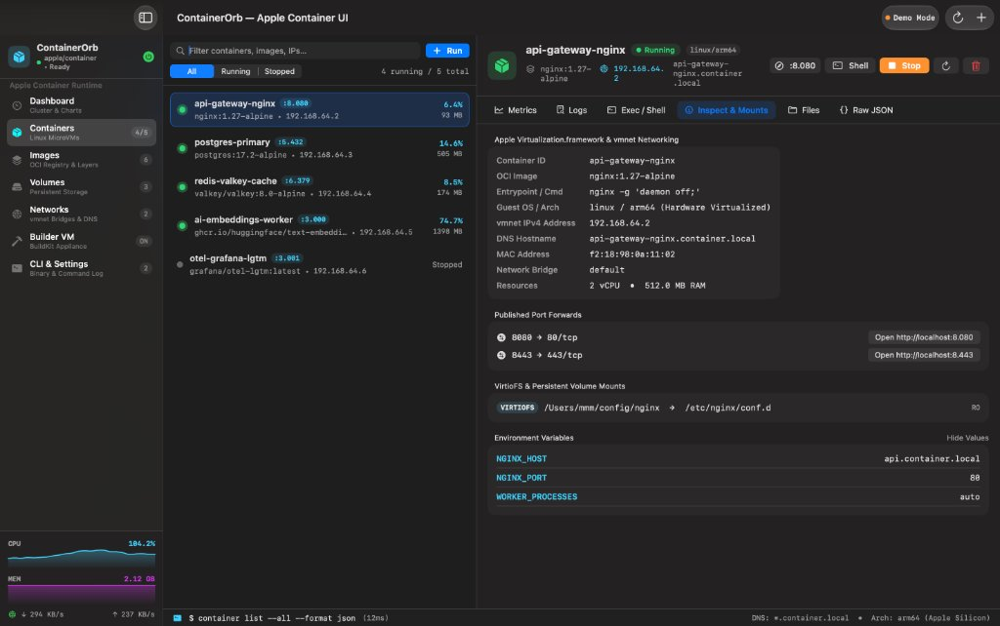

# Vessel — Native macOS Container Studio for `apple/container`

**Vessel** is a fast, lightweight (~2.5 MB), 100% native macOS desktop UI built with **SwiftUI + Swift Charts** for Apple's Linux microVM container runtime ([github.com/apple/container](https://github.com/apple/container)) with built-in, zero-conversion **`docker-compose.yml`** support.


---

## Step-by-Step Getting Started

### Step 1 — Install & Start Apple's `container` Engine
Vessel runs on top of Apple's official `container` runtime (requires an **Apple Silicon Mac** running **macOS 15+**).

1. **Install `apple/container`** (via Homebrew or the [official `.pkg` installer from GitHub Releases](https://github.com/apple/container/releases)):
   ```bash
   brew install --cask container
   ```
2. **Start the background system service:**
   ```bash
   container system start
   ```
3. *(Optional)* **Enable local DNS for container-to-container discovery (`*.test`):**
   ```bash
   sudo container system dns create test
   container system property set dns.domain test
   ```

---

### Step 2 — Install Vessel via Homebrew
Install **Vessel** directly from our Homebrew tap:

```bash
brew tap middt/vessel https://github.com/middt/apple-container-ui
brew install --cask vessel
```

Then open **Vessel** from `/Applications/Vessel.app` (or Spotlight):
```bash
open -a Vessel
```

---

### Step 3 — Run Your First Container
You can launch a Linux microVM container in two ways:

#### Option A: From the Vessel UI (1-Click)
1. Click **`+ Run Container`** (`Cmd + N`) in the top-right toolbar (or pick a 1-click template such as **`httpbin`**, **`nginx`**, **`postgres`**, or **`valkey`** on the **Dashboard**).
2. Set the container name (e.g. `httpbin`), image (`mccutchen/go-httpbin:v2.15.0`), vCPUs, memory, and port (`8090 → 8080/http`).
3. Click **`Create & Boot MicroVM`**.
4. Once running, click **`:8090`** (or **`Open http://localhost:8090`**) to open it in your browser, or click **`Shell`** to open an interactive terminal inside the microVM.

#### Option B: From the Terminal (Instantly Appears in Vessel)
```bash
container run -d --name httpbin --cpus 2 --memory 512M --publish 8090:8080 mccutchen/go-httpbin:v2.15.0
```
Test the running service:
```bash
curl -s http://localhost:8090/get
```

---

### Step 4 — Run a `docker-compose.yml` Stack (Zero Conversion)
Apple's `container` CLI does not natively parse `docker-compose.yml` files. **Vessel** includes a built-in Compose orchestrator that runs standard `docker-compose.yml` files directly on `apple/container` without converting anything manually.



1. Open the **`Compose Stacks`** tab (`Cmd + 3`) in the left sidebar.
2. Click **`Import YAML`** and select any `docker-compose.yml` file (or use one of the built-in stacks in [`examples/`](examples/)).
3. Select your target runtime in the top-right dropdown:
   - **`Apple Container (MicroVM)`** — runs each service directly as an isolated Apple `Virtualization.framework` microVM in dependency order (`depends_on`).
   - **`Docker CLI Engine`** — runs the stack via `docker compose up -d` if Docker is installed.
4. Click **`Stack Up`**.
   - All services in the stack are automatically grouped together in the **Containers** tab with aggregate CPU/RAM charts and bulk **Start / Stop / Restart / Delete** controls.

#### Headless CLI Stack Deploy (Optional)
You can also deploy any `docker-compose.yml` file on `apple/container` from the terminal using Vessel's helper script:
```bash
./scripts/stack-up.sh examples/httpbin-gateway/docker-compose.yml
```

---

## Application Screenshots

### 1. Cluster Dashboard & Real-Time Charts
Live 1Hz cluster CPU, Memory, `vmnet` Network RX/TX, and Disk I/O telemetry alongside per-container resource distribution and 1-click microVM templates.


### 2. Containers Inspector (Metrics, Logs, Exec/Shell, Mounts, Files & Raw JSON)
Grouped by Compose project with protocol-aware port actions (**Open in Browser** & **Test HTTP Output** for HTTP/HTTPS services; **Copy TCP Endpoint** for raw TCP databases like PostgreSQL and Redis/Valkey).



### 3. Zero-Conversion `docker-compose.yml` Stack Manager
Edit `docker-compose.yml` live, inspect the generated `apple/container` execution plan, and view combined multi-service stack logs.


---

## Building from Source (For Developers)

No full Xcode installation is required — **CommandLineTools** (`swiftc`) on macOS 15+ is sufficient:

```bash
# Run the unit test suite:
./scripts/test.sh

# Build & sign dist/Vessel.app (Release, arm64):
./scripts/bundle-app.sh

# Launch the app:
open dist/Vessel.app
```

---

## Documentation

| Document | Description |
| :--- | :--- |
| **[User Guide (`docs/USER_GUIDE.md`)](docs/USER_GUIDE.md)** | Complete walkthrough of all screens, keyboard shortcuts, and features. |
| **[Docker & Compose Guide (`docs/COMPOSE_AND_DOCKER_GUIDE.md`)](docs/COMPOSE_AND_DOCKER_GUIDE.md)** | How zero-conversion `docker-compose.yml` orchestration works on `apple/container`. |
| **[Architecture (`docs/ARCHITECTURE.md`)](docs/ARCHITECTURE.md)** | Internal architecture, CLI parsers, Compose DNS networking, and build pipeline. |
| **[AI Agent Guide (`AGENTS.md`)](AGENTS.md)** | Coding conventions and compiler constraints for AI coding assistants. |
| **[AI Development Roadmap (`docs/AI_DEVELOPMENT_ROADMAP.md`)](docs/AI_DEVELOPMENT_ROADMAP.md)** | Next phases and ready-to-use prompts for extending Vessel. |
