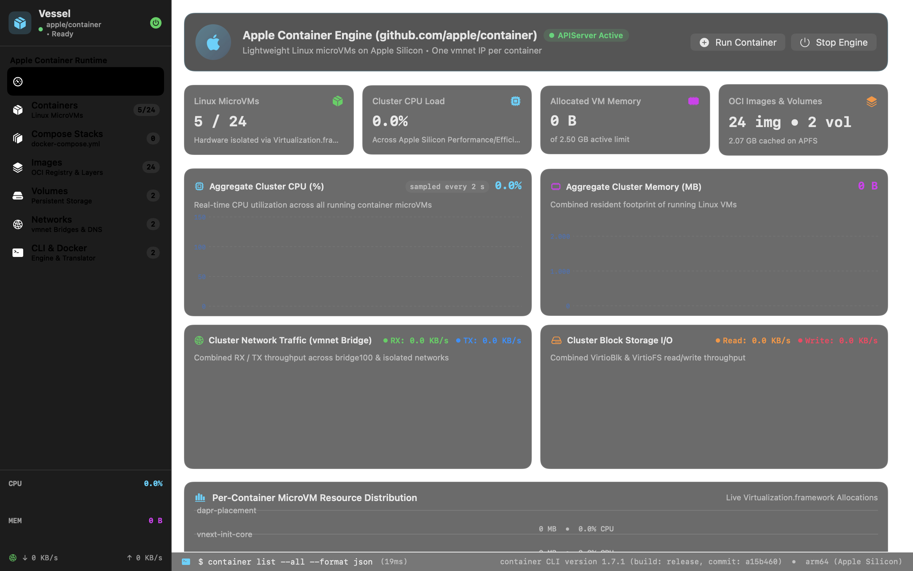

# Vessel — Native macOS Container Studio for `apple/container`

**Vessel** is a fast, lightweight (~2.5 MB), 100% native macOS desktop UI and unified CLI (`vessel`) built with **SwiftUI + Swift Charts** for Apple's Linux microVM container runtime ([github.com/apple/container](https://github.com/apple/container)) with built-in, zero-conversion **`docker-compose.yml`** support.


---

## Step-by-Step Getting Started

### Step 1 — Install Apple's `container` Engine & Vessel via Homebrew
Vessel runs on top of Apple's official `container` runtime (requires an **Apple Silicon Mac** running **macOS 15+**). Installing **Vessel** via Homebrew installs both `/Applications/Vessel.app` (with automatic Gatekeeper quarantine removal) and the **`vessel`** CLI command:

```bash
# 1. Install Apple's container engine:
brew install --cask container

# 2. Install Vessel (Desktop App + 'vessel' CLI):
brew tap middt/vessel https://github.com/middt/apple-container-ui
brew install --cask vessel
```

---

### Step 2 — Start the Engine & Launch Vessel
You can manage the engine and containers using the **`vessel`** CLI command or from the **Vessel** desktop app:

```bash
# 1. Start the background container engine:
vessel system start

# 2. Verify the engine status:
vessel system status

# 3. (Optional) Enable local DNS so containers in a Compose stack can resolve each other by service name (*.test):
sudo vessel system dns create test
vessel system property set dns.domain test

# 4. Launch the Vessel desktop app:
open -a Vessel
```

---

### Step 3 — Run Your First Container
You can spin up a Linux microVM container either from the **Vessel UI** or directly from the **terminal** using `vessel run` (any container started in the terminal immediately appears in Vessel with live CPU, Memory, Network, and Disk charts).

#### Option A: From the Vessel UI
1. Click **`+ Run Container`** (`Cmd + N`) in the top-right toolbar (or click **Launch** on any 1-click template such as **`httpbin`**, **`nginx`**, **`postgres`**, or **`valkey`** on the **Dashboard**).
2. Enter the container settings:
   - **Name:** `httpbin`
   - **Image:** `mccutchen/go-httpbin:v2.15.0`
   - **Resources:** `2 vCPU`, `512 MB RAM`
   - **Port:** `8090` → `8080` (`HTTP`)
3. Click **`Create & Boot MicroVM`**.
4. Once running, click **`:8090`** (or **`Open http://localhost:8090`**) to open it in your browser, or click **`Shell`** to open an interactive terminal inside the microVM.

#### Option B: Example Terminal Commands (`vessel`)
```bash
# Start an httpbin microVM container (2 vCPU, 512 MB RAM, port 8090 -> 8080):
vessel run -d --name httpbin --cpus 2 --memory 512M --publish 8090:8080 mccutchen/go-httpbin:v2.15.0

# Start a PostgreSQL 17 microVM container (port 5432):
vessel run -d --name postgres-dev --cpus 2 --memory 1024M --publish 5432:5432 --env POSTGRES_PASSWORD=postgres postgres:17-alpine

# List running containers and test the HTTP endpoint:
vessel list
curl -s http://localhost:8090/get
```

---

### Step 4 — Run a `docker-compose.yml` Stack (Zero Conversion)
Apple's `container` CLI does not natively parse `docker-compose.yml` files. **Vessel** includes a built-in Compose orchestrator that runs standard `docker-compose.yml` files directly on `apple/container` without any manual conversion.


1. Save the following sample file as `docker-compose.yml` (or use any existing `docker-compose.yml` project on your Mac):
   ```yaml
   version: "3.9"
   services:
     httpbin:
       image: mccutchen/go-httpbin:v2.15.0
       cpus: 2
       mem_limit: 512m
       ports:
         - "8090:8080/http"
     api-gateway:
       image: nginx:1.27-alpine
       cpus: 2
       mem_limit: 512m
       ports:
         - "8080:80/http"
       depends_on:
         - httpbin
     cache:
       image: valkey/valkey:8.0-alpine
       cpus: 1
       mem_limit: 512m
       ports:
         - "6379:6379/tcp"
   ```
2. **Deploy from the Vessel UI:**
   - Open the **`Compose Stacks`** tab (`Cmd + 3`) in the left sidebar.
   - Click **`Import YAML`** and select your `docker-compose.yml` file.
   - Set the engine dropdown in the top-right to **`Apple Container (MicroVM)`** (or **`Docker CLI Engine`** to run via `docker compose`).
   - Click **`Stack Up`**.
3. **Or Deploy Directly from the Terminal (`vessel stack-up`):**
   ```bash
   # Deploy any docker-compose.yml file directly on Apple Container:
   vessel stack-up docker-compose.yml

   # Verify the running services and HTTP endpoints:
   vessel list
   curl -s http://localhost:8090/get
   curl -I http://localhost:8080

   # Stop and remove the stack when done:
   vessel stack-down docker-compose.yml
   ```

---

## Application Screenshots

### 1. Cluster Dashboard & Real-Time Charts
Live cluster CPU, Memory, `vmnet` Network RX/TX, and Disk I/O telemetry alongside per-container resource distribution and 1-click microVM templates.



### 2. Containers Inspector (Metrics, Logs, Exec/Shell, Mounts, Files & Raw JSON)
Grouped by Compose project with protocol-aware port actions (**Open in Browser** & **Test HTTP Output** for HTTP/HTTPS services; **Copy TCP Endpoint** for raw TCP sockets like PostgreSQL and Redis/Valkey).


### 3. Zero-Conversion `docker-compose.yml` Stack Manager
Edit `docker-compose.yml` live in the UI, inspect the generated `apple/container` execution plan, and view combined stack logs.


---

## Documentation

| Document | Description |
| :--- | :--- |
| **[User Guide (`docs/USER_GUIDE.md`)](docs/USER_GUIDE.md)** | Complete walkthrough of all screens, `vessel` CLI commands, keyboard shortcuts, and features. |
| **[Docker & Compose Guide (`docs/COMPOSE_AND_DOCKER_GUIDE.md`)](docs/COMPOSE_AND_DOCKER_GUIDE.md)** | How zero-conversion `docker-compose.yml` orchestration works on `apple/container`. |
| **[Architecture (`docs/ARCHITECTURE.md`)](docs/ARCHITECTURE.md)** | Internal architecture, CLI parsers, Compose DNS networking, and build pipeline. |
