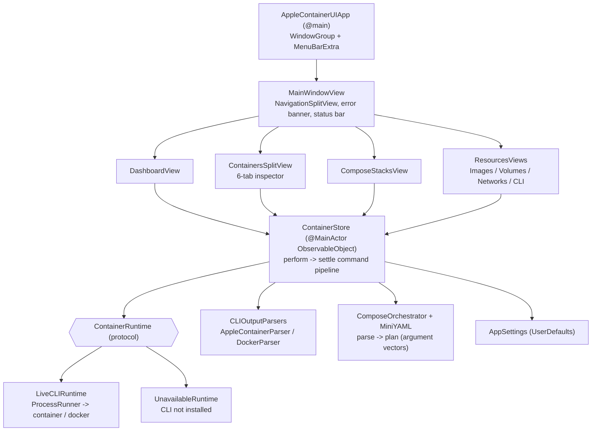

# Vessel — Technical Architecture

This document describes the internal architecture, data flow, localization system, and build pipeline of **Vessel**.

---

## 1. Architecture Diagram



---

## 2. Directory & File Structure

```text
apple-container-ui/
├── Package.swift                          # SwiftPM manifest (used for `swift test`)
├── scripts/
│   ├── bundle-app.sh                      # Release build, dist/Vessel.app bundle, code signing
│   ├── test.sh                            # Runs the unit tests with CommandLineTools
│   ├── stack-up.sh                        # Headless "Stack Up" for a Compose file (same code path as the UI)
│   └── Vessel.entitlements                # Hardened-runtime entitlements (Apple Events for Terminal.app)
├── examples/                              # Sample Compose stacks (incl. vnext-runtime: 20 containers, Dapr sidecars)
├── Tests/AppleContainerUITests/
│   ├── ShellAndProcessTests.swift         # ShellWords, ProcessRunner (large output, timeout), Terminal script
│   ├── ComposeTests.swift                 # MiniYAML, Compose parsing, execution plan, docker translator
│   ├── ParserTests.swift                  # CLI output parsers (fixtures)
│   └── StoreTests.swift                   # ContainerStore and groups against a FakeEngine, real-CLI read-only checks, opt-in end-to-end run
└── Sources/AppleContainerUI/
    ├── AppleContainerUIApp.swift
    ├── Models/
    │   ├── AppLocalization.swift
    │   └── ContainerModels.swift
    ├── Services/
    │   ├── ContainerRuntime.swift         # protocol + LiveCLIRuntime + UnavailableRuntime
    │   ├── ContainerCLIService.swift      # ProcessRunner, binary detection, Terminal.app launcher
    │   ├── ShellWords.swift               # shell splitting / quoting
    │   ├── CLIOutputParsers.swift         # real CLI output -> models
    │   ├── MiniYAML.swift                 # YAML subset parser
    │   ├── ComposeOrchestrator.swift      # Compose parsing and apple/container plans
    │   ├── DockerCommandTranslator.swift  # docker -> container translator
    │   ├── AppSettings.swift              # persisted preferences
    │   ├── ContainerStore.swift           # state, modes, command pipeline, telemetry timer
    │   ├── ContainerStore+Actions.swift   # user actions
    │   ├── ContainerStore+Compose.swift   # stack deployment / teardown
    │   ├── ContainerStore+Groups.swift    # Compose project groups and bulk actions
    │   └── ContainerStore+Live.swift      # reading state back from the CLIs
    └── Views/                             # MainWindow, Dashboard, Containers, ContainerGroupViews, Compose, Resources, NewContainerSheet, charts
```

---

## 3. Runtimes and the Command Pipeline

Each backend (`apple/container`, `docker`) has its own `ContainerRuntime`: `LiveCLIRuntime` when the binary is found, `UnavailableRuntime` otherwise (every command fails with "CLI not found"). There is no demo mode and no sample data — the UI only ever shows what a CLI reported.

Every action has the same shape:

1. Optionally show a transient state (`starting` / `stopping`).
2. `perform(backend, arguments)` — runs the argument vector on the backend's runtime, records it in the audit log, and puts failures into `errorBanner`.
3. `settle()` — re-reads the real state from the CLI (`refreshFromLiveCLI`).
4. On failure the previous state is restored.

Because the UI state is always what the CLI reported, a failed command can never leave the UI claiming success.

### Compose groups (`ContainerStore+Groups.swift`)

Containers carrying the `com.docker.compose.project` label (set by `docker compose` and by Vessel's own stack deployment) form a `ContainerGroup` per project and engine. The container list shows each group under a collapsible header; selecting the header opens the group dashboard.

- `ContainerGroup` derives its numbers from its members: running count, CPU % (sum, 100% = one core), memory usage / limit, and `metricsHistory` (member samples summed per sampling instant — members of a backend are sampled together, so the timestamps line up).
- Bulk actions: `stopGroup` (one `stop` with all running members), `startGroup` (`container start` per member in `depends_on` order when the stack is known; one `docker start` for Docker), `restartGroup`, and `deleteGroup` (`container delete --force` plus the stack's network, or `docker compose --project-name <p> down`). Deleting asks for confirmation; named volumes are kept.

### Reading live state (`ContainerStore+Live.swift`)

- `container system status --format json` decides `engineState` (the CLI exits 0 even when stopped, so the JSON `status` field is authoritative).
- `container list --all --format json`, plus `docker ps -aq` + `docker inspect` when the Docker daemon is reachable. Results are merged by name so metric history, counters and logs survive a refresh.
- Images, volumes and networks are re-read after actions and on manual refresh (Cmd+R).
- Every 2 s — every 10 s while Vessel is in the background — `container stats` / `docker stats`. Rates are computed from the real elapsed time per container, overlapping polls are skipped, and one publish is made per poll.
- Only for the tab on screen, and only while Vessel is frontmost: `logs -n 200`, `inspect`, and `exec <id> ls -la /`.
- A refresh requested while another is in flight is queued, not dropped.
- **Local Network permission** (`verifyPublishedPorts`): macOS can deny `container-runtime-linux` access to the container network; the host port then accepts connections and resets them, with no error anywhere. After each list refresh Vessel opens a TCP connection to the published port of every container it has not verified yet (keyed by name and start time), then scans `container system logs --last 1m` for the forwarder's `No route to host (errno: 65)` lines newer than the probe. Affected containers go into `localNetworkBlockedContainers` (warning banner with a Settings shortcut). Flagged containers are re-probed every 30 s, which clears the warning after the permission is granted. A container that is merely not listening yet fails with errno 61 and is not flagged.

Parsers leave fields the CLI did not report empty; the views show "—".

---

## 4. Compose on `apple/container`

`ComposeOrchestrator.parse` uses `MiniYAML` (block maps/lists at any indentation, quote-aware comments, single- and multi-line flow collections, block scalars, anchors and merge keys) and supports:

`image`, `build`, `command`, `entrypoint`, `container_name`, `environment`, `env_file`, `ports`, `volumes` (bind, named, `tmpfs`), `depends_on` with `condition`, `healthcheck`, `cpus`, `mem_limit`, `deploy.resources.limits`, `labels`, `working_dir`, `user`, `cap_add` / `cap_drop`, `profiles` (`COMPOSE_PROFILES`), top-level `networks` and `volumes` (`external`, `name`), `restart` (warning only), and `${VAR}` interpolation from the shell environment and the project's `.env` file.

`buildAppleContainerPlan` turns a stack into `ComposePlanStep`s, executed in dependency order by `deployStack`. A step is a command (an argument vector), or a wait:

1. `container delete --force` for containers left from a previous deployment
2. `container network create` (optional) — `<stack>_default`, or the first declared network; `external` networks keep their name and are never deleted by "Stack Down"
3. `container volume create` for named volumes (optional) — `<stack>_<volume>` unless `external` / named
4. per service, before it starts: one wait per `depends_on` condition — `.waitHealthy` polls the dependency's healthcheck through `container exec`; `.waitExited` polls `container list` until a one-shot container has stopped
5. per service: `container build` (if `build:` is set), then `container run --detach …`

**Service discovery.** Containers on `apple/container` only resolve each other by name when a local DNS domain exists (`sudo container system dns create <domain>`; Vessel reads it with `container system dns list` into `store.dnsDomain`). With a domain, every service gets `--network <net>,alias=<service>.<zone>,alias=<container>.<zone>` and `--dns-search <zone>`, where `<zone>` is `<network>.<domain>` — a per-network scope like Docker's embedded DNS, so equal service names in unrelated stacks do not collide (aliases must be unique) while stacks on a shared external network can reach each other. Without a domain the stack carries a warning with the command to run.

**Not possible on `apple/container`:** `network_mode: service:<x>` (no shared network namespaces — each container is a VM), restart policies, and health monitoring after startup. A failing non-optional step aborts the plan and is reported. "Stack Down" runs `container stop` + `container delete --force` (+ `network delete` for the stack's own network), or `docker compose down`.

`examples/vnext-runtime/` is a real 20-container deployment that exercises all of this; `scripts/stack-up.sh` (the `StackUpTool` test) deploys any Compose file headlessly through `ContainerStore.deployStack`.

For the Docker target the YAML is written to a temporary file and run with `docker compose --project-name … --project-directory <original dir> --file … up --detach`. Vessel's `/http` and `/https` port hints are stripped from that copy because Docker only accepts `tcp` / `udp`.

---

## 5. Key Technical Design Decisions

1. **CommandLineTools compatibility (`ObservableObject` instead of the `@State` / `@Observable` macros):** external SwiftUI macros need a plugin binary that CommandLineTools does not ship, so Vessel uses `ObservableObject`, `@Published`, `@StateObject` and `@ObservedObject` and compiles with plain `swiftc`.
2. **Process execution:** `ProcessRunner` drains stdout and stderr concurrently while the child runs (reading after `waitUntilExit()` deadlocks once ~64 KB are buffered), closes stdin, and enforces a timeout.
3. **No shell:** commands are argument vectors end to end. The only place a command line is built is the Terminal.app launcher, where every argument is shell-quoted and the line is embedded as an AppleScript string literal.
4. **Automatic language detection with English fallback (`AppLocalization`)**, overridden by the persisted user choice.
5. **Protocol-aware ports (`PortAppProtocol`):** engines only know `tcp` / `udp`. `http` / `https` are UI hints, inferred from well-known ports or given explicitly, and re-applied when live state is read back.
6. **Rendering cost:** each poll mutates a local copy of the container list and publishes once, so views re-render once per sample. Hover state is kept out of the store's published state (`HoverState`), so moving the mouse over the container list re-renders only the rows. Background polling is throttled.
7. **Confirmations:** destructive actions set `pendingConfirmation`; one dialog in `MainWindowView` serves them all.
